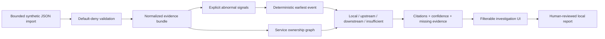

# IncidentLens architecture

## Boundary

IncidentLens correlates already-supplied evidence. It does not capture traffic, query production systems, diagnose code, or infer an unrecorded cause. All current inputs are fictional public fixtures loaded through an in-memory adapter.

## Deterministic rules

1. Only explicit error/fatal logs, error spans, failed/rolled-back deployments, and rejected/rolled-back configuration changes qualify as abnormal.
2. Events sort by timestamp, then stable source priority (`trace`, `log`, `deployment`, `config`), then record ID.
3. The first sorted event is the earliest evidence-backed abnormal event.
4. Ownership edges classify its service relative to the ticket's affected service: same service is local; a declared dependency is upstream; a service depending on the affected service is downstream; an unknown relation is insufficient evidence.
5. Two distinct sources on that service within one minute plus a known topology relationship produce high confidence. One source plus known topology is medium. Unknown topology is low.
6. Confidence measures evidence coverage, never causal certainty.

## Contracts

`src/adapters/contracts.ts` defines separate ticket, span, log, deployment, configuration, and ownership records. `SyntheticEvidenceAdapter` is the only implementation. Real vendors and credentials are intentionally outside this increment.

`src/lib/evidence-import.ts` accepts at most 256 KiB by default, rejects unknown or sensitive-looking fields, requires public `INC-SYN-` ticket identifiers, validates record limits and timestamps, and checks span/log references before returning a normalized bundle. Invalid input never reaches correlation.

## Investigation experience

The responsive UI consumes `IncidentCorrelation` without recalculating classification. It presents the affected service, declared dependencies, and evidence lead as an ownership-backed path; maps all supplied synthetic records into an ordered, source-filterable timeline; and keeps the selected source record visible beside the timeline. Confidence is labelled evidence coverage, missing source groups are explicit, and every conclusion remains attached to source and record identifiers.

The export is a local Markdown file and is disabled until a human confirms that they reviewed the cited evidence and understand the result is a triage lead rather than a diagnosis. The report repeats the confidence rationale, missing evidence, citations, and optional reviewer note. It does not create or update a ticket, message a team, assign ownership, or connect to an external system.

The local import control reads one user-selected JSON file in browser memory, rejects files beyond the parser boundary before reading, and displays every validation issue before correlation. Cancel and retry leave the last accepted synthetic investigation unchanged. No file name, content, or result is uploaded.
