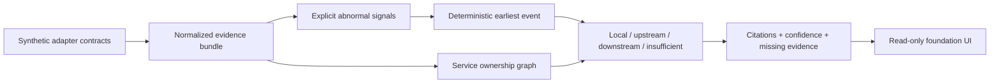

# IncidentLens architecture

## Boundary

IncidentLens correlates already-supplied evidence. It does not capture traffic, query production systems, diagnose code, or infer an unrecorded cause. All current inputs are fictional public fixtures loaded through an in-memory adapter.

## Deterministic rules

1. Only explicit error/fatal logs, error spans, failed/rolled-back deployments, and rejected/rolled-back configuration changes qualify as abnormal.
2. Events sort by timestamp, then stable source priority (`trace`, `log`, `deployment`, `config`), then record ID.
3. The first sorted event is the earliest evidence-backed abnormal event.
4. Ownership edges classify its service relative to the ticket's affected service: same service is local; a declared dependency is upstream; a service depending on the affected service is downstream; an unknown relation is insufficient evidence.
5. Two distinct sources on that service within one minute plus a known topology relationship produce high confidence. One source plus known topology is medium. Unknown topology is low.
6. Confidence measures evidence coverage, never causal certainty.

## Contracts

`src/adapters/contracts.ts` defines separate ticket, span, log, deployment, configuration, and ownership records. `SyntheticEvidenceAdapter` is the only implementation. Real vendors and credentials are intentionally outside this increment.

## Next integration

Quinn can build a responsive investigation UI around `IncidentCorrelation`: evidence timeline, source filters, citation selection, missing-evidence callout, and an explicit no-root-cause disclaimer. The UI should consume the existing result rather than recalculate classification.
