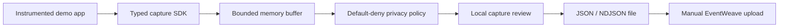
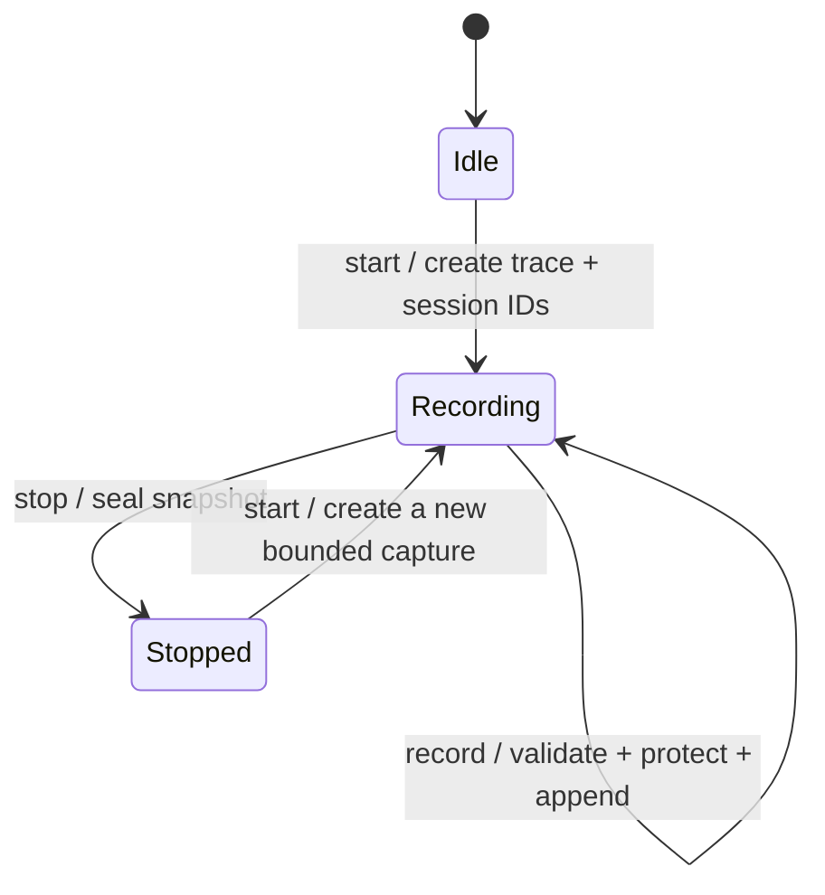
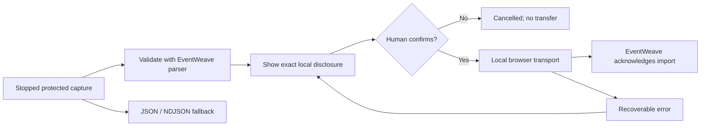
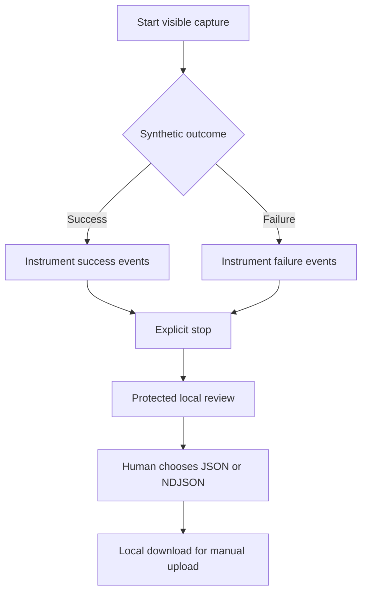

# TraceRelay architecture

## Product boundary

TraceRelay will create the structured evidence that EventWeave analyzes. Version one stays entirely local: an explicitly instrumented application records one bounded journey, applies a default-deny privacy policy, allows a human to review the result, and exports a file for manual EventWeave upload.

## Capture core

The capture core is a UI-independent boundary. It accepts only explicit instrumentation calls while a session is recording, protects attributes before retaining an event, and refuses new events at the configured hard limit so existing parent evidence is never silently removed.

Review snapshots retain privacy-treatment metadata for a human. EventWeave projections contain only approved or masked primitive attributes. JSON and NDJSON serialization preserve record order, stable IDs, ISO timestamps, outcomes, durations, and valid earlier-parent links.

The compatibility boundary is executable rather than assumed. A cross-project integration test sends both serializers through EventWeave's production parser, compares their normalized traces, verifies ordered event and parent relationships, and confirms masked values remain masked while removed credentials never cross the boundary.

Version two adds a separate local handoff contract. TraceRelay first creates the same protected JSON payload and validates it with EventWeave's production parser. It then derives a disclosure from that exact payload: bytes, events, actors, types, parent links, approved or masked attributes, and counts of fields already removed or masked. Preparing this contract sends nothing. A handoff session can send only after explicit confirmation, supports abort while in flight, and retains the reviewed payload after a failure so retry does not re-record or silently change evidence.

The browser transport places only a one-time handoff ID and the initiating local origin in the target URL fragment; trace content never enters a URL, request, storage layer, or server. EventWeave announces readiness to the opener, and TraceRelay accepts that signal only from the exact target origin and popup window. EventWeave likewise accepts the import only from the declared opener and origin, parses it with its production contract, and acknowledges the matching ID. A blocked popup, timeout, cancellation, or rejected contract returns to a recoverable local state while file downloads remain usable.

## Current product-experience slice

The Lumen workflow now drives the merged capture core through explicit instrumentation. A user must start recording, choose one synthetic outcome, and stop the capture before the review can export a local file.

The initial fixture remains only as a clearly labelled sample before the first recording. Generated reviews come from `CaptureCore.toReview`; download content comes from the stopped core's deterministic serializers. Safe filenames are derived from the synthetic capture name and trace ID. The browser boundary creates one temporary object URL, clicks a short-lived download link, removes it, and schedules URL revocation. That boundary is dependency-injected in tests, and a blocked browser download produces an actionable status message without changing the sealed capture.

## Privacy and safety constraints

- Capture is explicit, visible, bounded, and local.
- Attribute collection is default-deny.
- Passwords, tokens, payment data, arbitrary DOM content, and company data are never collected.
- Protected values must be masked or removed before the review model is rendered.
- Sensitive key families are removed even when mistakenly listed in the allow policy.
- The event cap rejects additional events and reports the count; it never evicts parent evidence.
- Version one exports a file only after local review; it never uploads automatically.
- The interface must describe missing functionality honestly and must not create a file from unvalidated sample data.

## Ownership

- **Atlas:** capture schema, SDK lifecycle, bounded buffer, identifiers, redaction, validation, compatibility, and core tests. The completed core boundary is implemented in `src/lib/capture-core.ts`.
- **Lumen:** capture review, recording controls, export workflow, explicit handoff confirmation, strict-origin browser acknowledgement, demo journey, accessibility, responsive behavior, browser review, and integration documentation. The workflow intentionally excludes automatic capture, remote upload, and trace retrieval.

Version-one scope and final verification are recorded in [closeout.md](./closeout.md).
